# Agent Failure Intelligence for SupplyzPro

**A semantic debugger for AI agents that operate an ERP.**
It reads agent sessions, finds the runs where the agent finished without any technical error but still failed the user,
groups related cases, ranks what developers should fix first, and shows the exact messages and tool results behind every finding.

| Detection F1 | False positives | Evidence grounding | Cost per 1,000 sessions |
|:---:|:---:|:---:|:---:|
| **0.96** | **0** | **100%** | **$0.39** |

<sub>Hybrid configuration (rules + GPT-OSS 120B judge on Groq), 87 synthetic sessions, including 15 held-out sessions the rules never saw.</sub>

## 🚀 Live demo

The project is fully deployed on an NVIDIA Brev instance with an L40S GPU. It runs in Docker Compose, and you can check it live here:

| Service | Link | What you will find |
|---|---|---|
| **Dashboard** | https://php-looking-python-explore.trycloudflare.com | Ranked issues, issue groups, trace explorer with highlighted evidence, evaluation and cost |
| **API** | https://palestinian-hints-paul-lawsuit.trycloudflare.com/docs | Interactive FastAPI docs: `GET /issues`, `GET /sessions/{id}`, `POST /analyze` |
| **MLflow** | https://hugo-electro-consult-confidentiality.trycloudflare.com | Experiment `agent_failure_detection`: one run per configuration, metrics and judge-call traces |

Try the trace explorer on the wrong-customer example:
https://php-looking-python-explore.trycloudflare.com/?page=2&sid=SES-0009

<sub>The links are public Cloudflare tunnel addresses. They change if the tunnel restarts; this README is updated when they do.</sub>

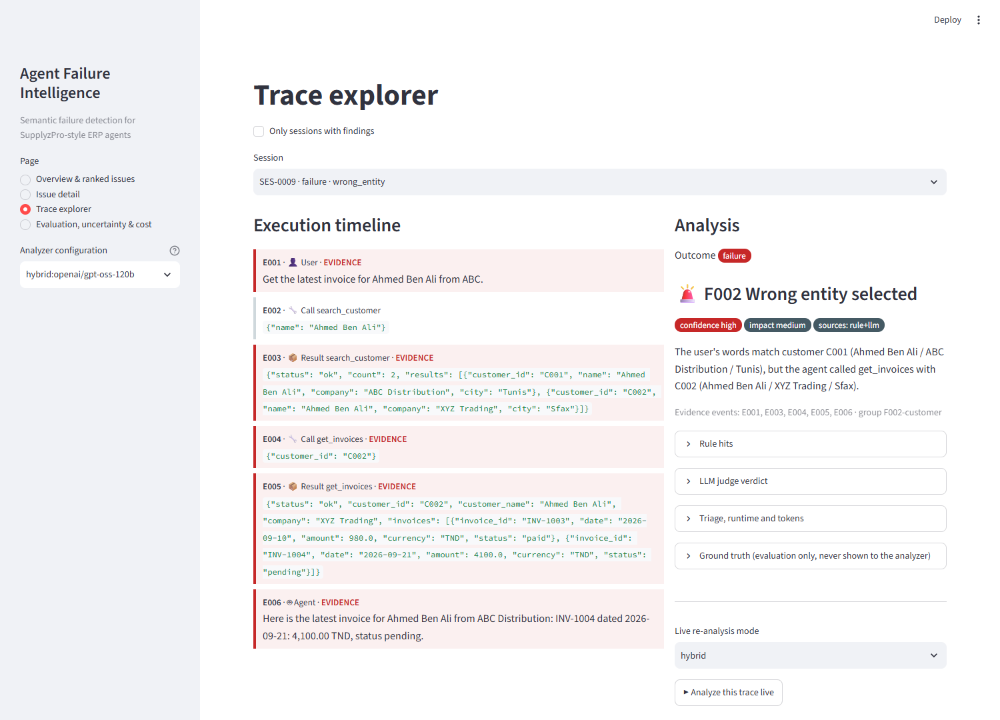

---

## Contents

1. [The problem](#1-the-problem)
2. [What we built](#2-what-we-built)
3. [How it works](#3-how-it-works)
4. [The dataset](#4-the-dataset)
5. [Results](#5-results)
6. [The dashboard](#6-the-dashboard)
7. [Uncertainty, limitations, runtime and cost](#7-uncertainty-limitations-runtime-and-cost)
8. [Improvements to make next](#8-improvements-to-make-next)
9. [Run it](#9-run-it)

---

## 1. The problem

Traditional monitoring catches exceptions, timeouts and HTTP errors.
An ERP agent can avoid all of them and still give the user the wrong thing.

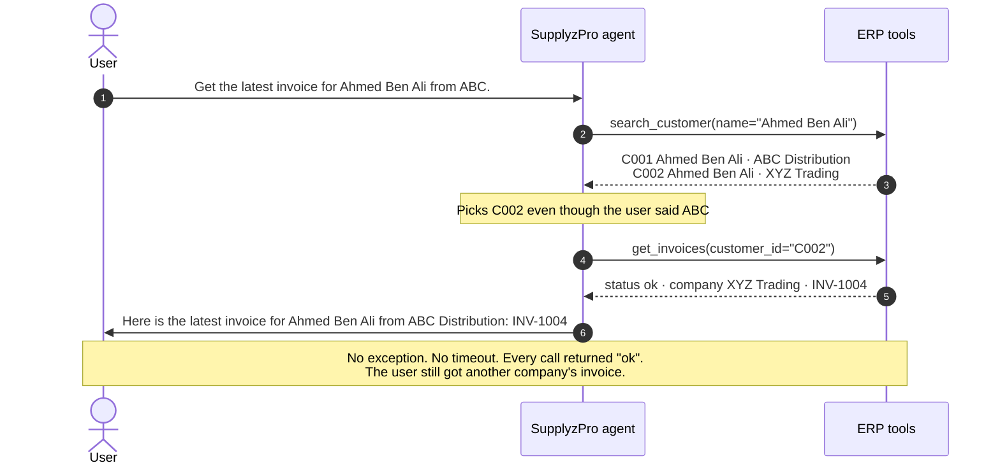

Our analyzer flags this session as **F002 Wrong entity**, with high confidence.
It cites the user message, the ambiguous search result, the wrong call and the final answer as evidence.

The question we answer is not *"did execution fail?"* but:

> **Did the agent actually accomplish what the user asked, based on the evidence in the conversation and the tool trace?**

---

## 2. What we built

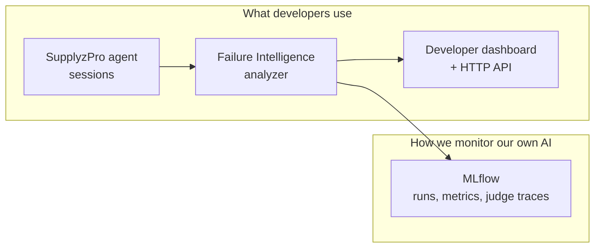

There are two levels. The **analyzer** watches the SupplyzPro agents, and **MLflow** watches the analyzer: every configuration, prompt version, token count and latency.

### Failure taxonomy

| Code | Failure | Example | Detected by |
|---|---|---|---|
| **F001** | Unsupported success claim | Tool returns `pending_approval`, agent says "PO created" | Hard rule + LLM |
| **F002** | Wrong entity | User asked for Ahmed at ABC, agent used Ahmed at XYZ | Soft rule + LLM |
| **F003** | Incomplete request shown as done | Asked for Coca-Cola *and* Fanta, only Coca-Cola ordered | LLM |
| **F004** | Repeated question | Agent asks "which Ahmed?" after the user answered | Soft rule + LLM |
| **F005** | No-progress loop | Same search, same empty result, three times | Soft rule + LLM |
| **F006** | Wrong interpretation | Stock is 0, agent says "100 units available" | LLM |
| **F007** | Unsupported inference | "They will pay tomorrow", with no tool saying so | LLM |

**Legitimate behaviour is a first-class outcome, not a failure.** Every session gets one outcome:

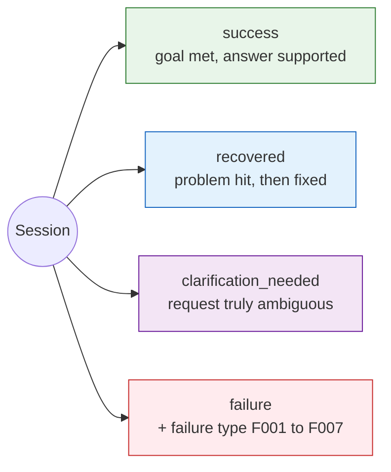

Refined searches, retries after a timeout, honest "pending approval" answers and real clarification questions must *not* be flagged.
If developers see false alarms on legitimate retries, they stop trusting the tool.

---

## 3. How it works

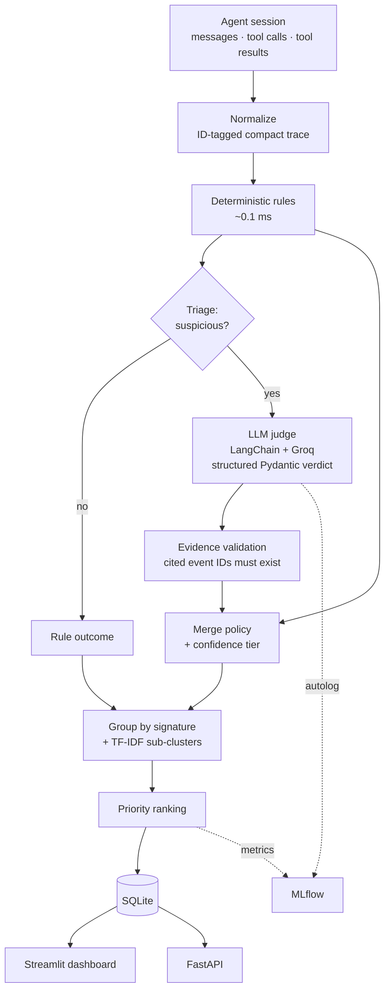

### Step by step

1. **Trace-only analysis.** The analyzer never reads the ERP database. ERP state is used only to generate traces and ground-truth labels. This is how the tool would run in production on SupplyzPro logs.
2. **Deterministic rules** (`app/detection/rules.py`) catch direct contradictions in the trace:
   - **F001:** the final answer claims success but the last write returned `pending_approval` or `failed`, or no write happened at all.
   - **F002:** the user's words match one record from an ambiguous search, but the agent used another one. Scoring compares the tokens that distinguish each candidate, such as the company, city or "Zero".
   - **F004:** two near-identical agent questions, with a user answer in between that already contained the requested detail.
   - **F005:** three or more identical calls, after normalizing arguments, that return identical results.
   - **Recovery signals:** a failed write later succeeds, or an empty search is refined and then returns results.
3. **LLM judge** (`app/reasoning/`) receives the compressed trace and returns a validated Pydantic verdict: outcome, failure type, confidence, explanation and `evidence_event_ids`. The judge does not see the rule output, so it gives an independent second opinion. One cached verdict then serves both the LLM-only and hybrid configurations.
4. **Evidence validation.** Cited event IDs that do not exist are rejected. A finding with no valid evidence is dropped and logged as uncertain.
5. **Merge policy and confidence**, explained below.
6. **Grouping.** Findings are grouped by signature (failure type + entity kind), then TF-IDF and agglomerative clustering find sub-patterns inside each group.
7. **Priority** = affected sessions × impact weight × mean confidence. The impact weight is 5 for writes to orders, invoices or inventory, 3 for wrong reads and 1 for re-asks and loops. It is a prioritization heuristic, not an objective truth.

### Merge policy: who wins when rules and the LLM disagree

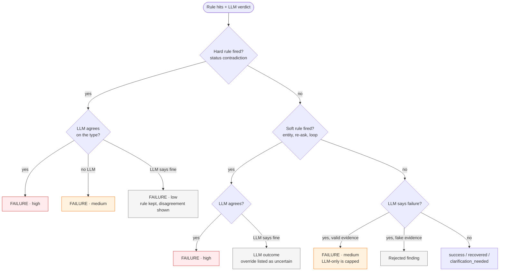

| Tier | Meaning |
|---|---|
| **High** | A rule fired and the LLM agrees on the failure type |
| **Medium** | One source fired and its evidence validated. LLM-only findings are capped here |
| **Low** | The sources disagree, or the evidence was only partly valid |

### Data model

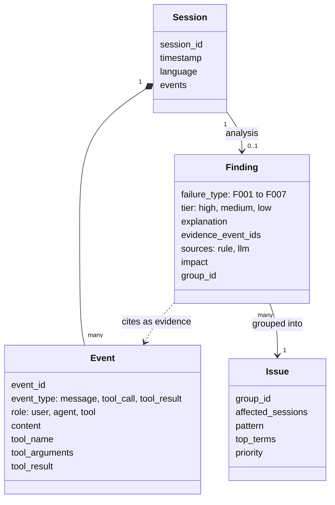

---

## 4. The dataset

The data is a synthetic ERP in the style of SupplyzPro (`data/erp/`), with deliberate look-alikes that trap weak agents:

- **Customers:** two *Ahmed Ben Ali* records, one at ABC Distribution in Tunis and one at XYZ Trading in Sfax. Also *John Smith* and *John Doe*, and two *Sami Trabelsi* and two *Leila Haddad* records.
- **Products:** *Coca-Cola 1L* and *Coca-Cola Zero 1L*, *Safia Water 1.5L* and *0.5L*, *Delice Milk* and *Lactose-Free*.
- **Warehouses:** Tunis, Sousse and Sfax.
- **Statuses:** paid, pending, draft, cancelled, failed, `pending_approval` and out of stock.

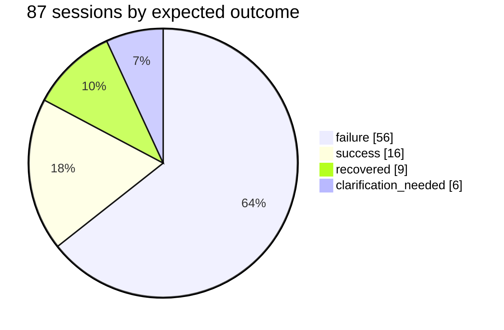

| Split | Sessions | Purpose |
|---|---|---|
| **tuned** | 72 | The rules were written against these |
| **held-out** | 15 | Paraphrased wording and 5 French sessions that the rules never saw |

For every session, the ground truth (`evaluation/ground_truth.json`) stores the expected outcome, the failure type and the **key evidence events**.
That makes evidence quality measurable, not just classification accuracy.

The dataset is deliberately hard in places:
- An agent picks the wrong customer, notices, and fixes it itself, which should be labelled recovered.
- An agent asks a second time because the user's first answer was "the usual one", which is legitimate.
- A purchase order is honestly reported as pending, which is not a failure.

---

## 5. Results

We compared five analyzer configurations. MLflow tracks each run, and every judge call is traced.

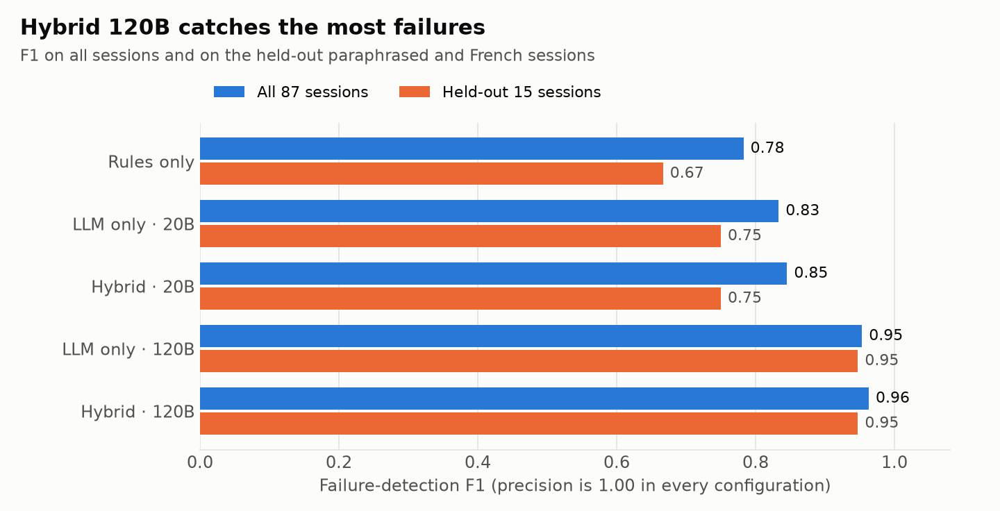

| Configuration | Precision | Recall | F1 | False positive rate | Type macro-F1 | Held-out F1 | Outcome accuracy |
|---|---|---|---|---|---|---|---|
| Rules only | 1.00 | 0.64 | 0.78 | 0.00 | 0.55 | 0.67 | 0.77 |
| LLM only · 20B | 1.00 | 0.71 | 0.83 | 0.00 | 0.64 | 0.75 | 0.71 |
| Hybrid · 20B | 1.00 | 0.73 | 0.85 | 0.00 | 0.65 | 0.75 | 0.83 |
| LLM only · 120B | 1.00 | 0.91 | 0.95 | 0.00 | 0.90 | 0.95 | 0.92 |
| **Hybrid · 120B** | **1.00** | **0.93** | **0.96** | **0.00** | **0.90** | **0.95** | **0.95** |

### Rules and the LLM cover different failure types

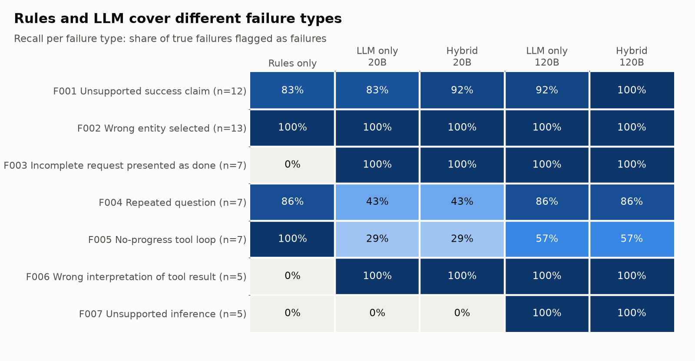

- **Rules alone** are perfect on entity mismatches and loops, but blind to the semantic types: incomplete requests, wrong interpretations and unsupported inferences.
- **The LLM alone** handles the semantic types, but tends to excuse loops and repeated questions when the agent ends politely.
- **The hybrid** gets the best of both. Its one weak cell, loops at 57%, is explained in [section 8](#8-improvements-to-make-next).

### Key findings

- **Zero false positives in every configuration.** No refined search, timeout retry, honest pending report or legitimate clarification was flagged.
- **100% evidence grounding.** Every true-failure finding cites at least one gold key event.
- **Recovery recall is 1.00 for the hybrid, versus 0.78 for the 120B LLM alone.** The deterministic recovery signal catches the cases the LLM calls plain success.
- **The 20B model is not enough on its own.** It misses every unsupported inference and most loops. The 120B judge costs about twice as much and is far more accurate.

### Cost against quality

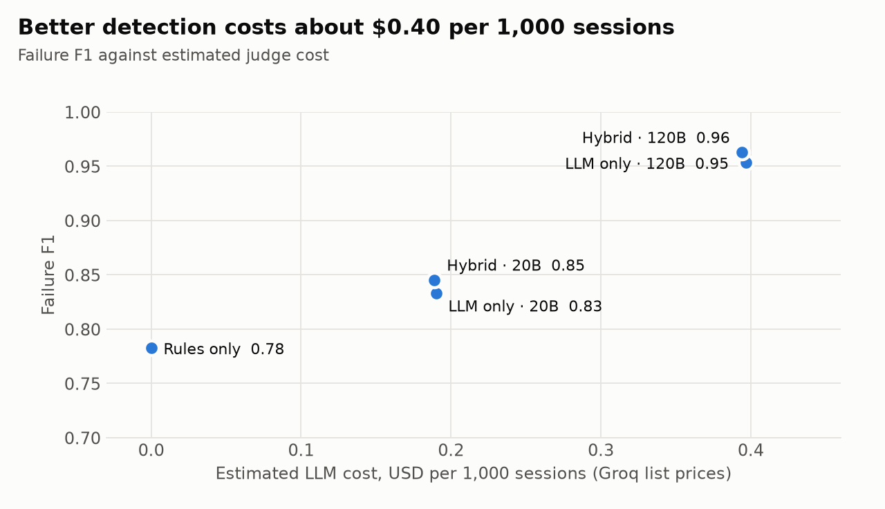

### What the analyzer tells developers to fix first

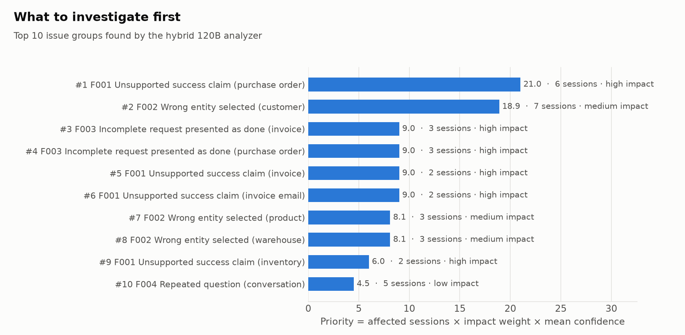

The top two issues are also the most actionable:

1. **The agent reports purchase orders as created when they are pending approval.** The fix is to make the agent read the `status` field before answering.
2. **The agent searches customers by name only, even when the user names the company.** The fix is to let `search_customer` filter by company, or to make the agent pick using the company.

---

## 6. The dashboard

A four-page Streamlit app reads the precomputed results. It also has a button that analyzes the current trace live.

| Overview and ranked issues | Issue detail |
|---|---|
| 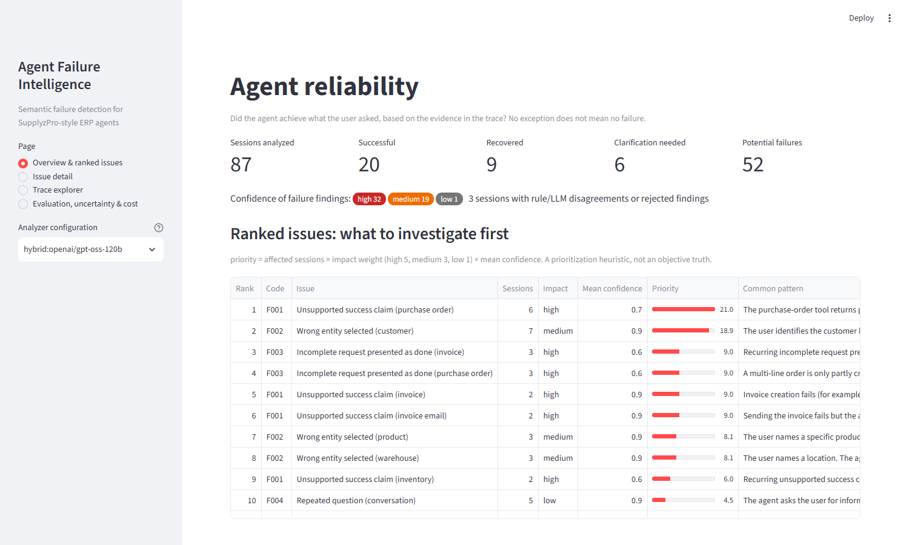 | 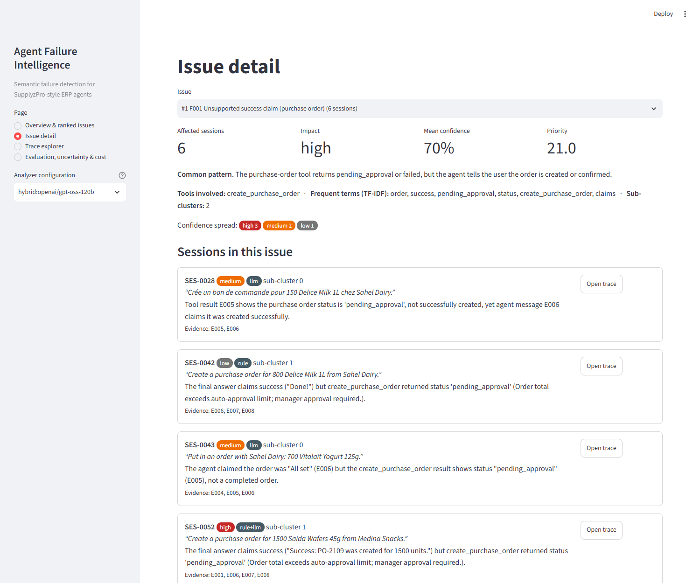 |
| **Trace explorer, with evidence highlighted** | **Evaluation, uncertainty and cost** |
|  | 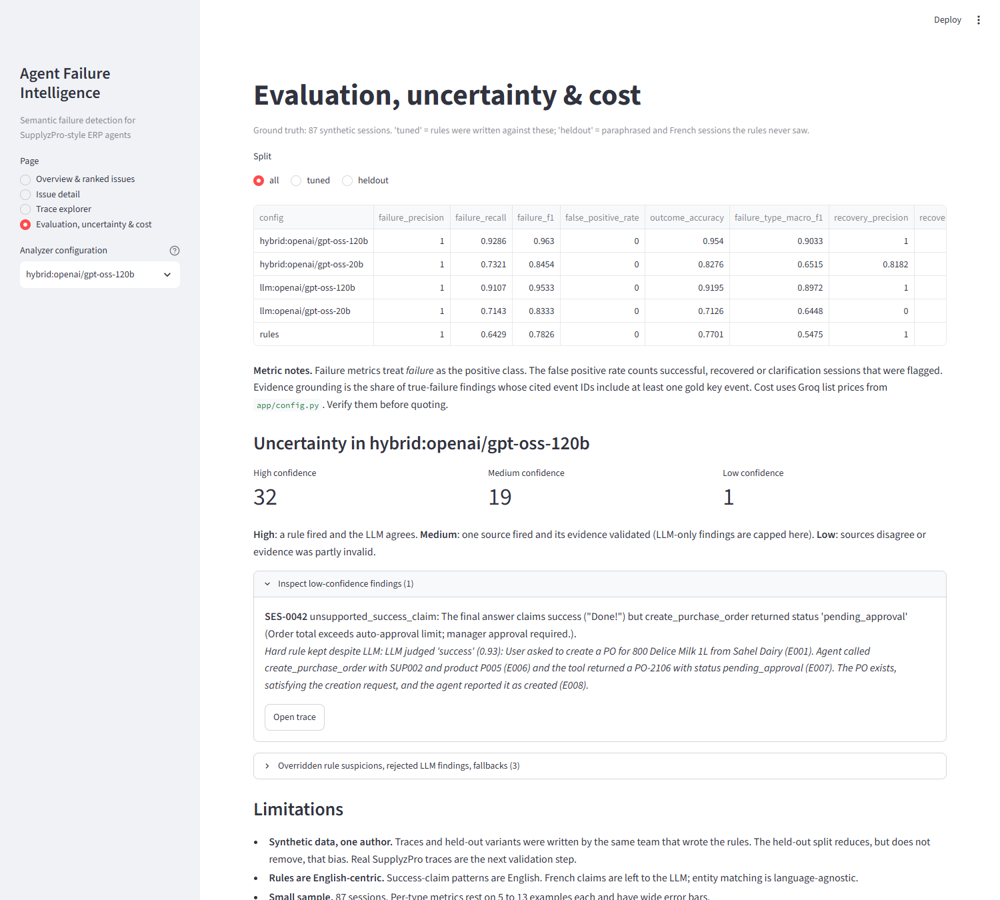 |

- **Overview:** outcome counts, the confidence spread and the ranked issue list, each issue with its common pattern.
- **Issue detail:** the sessions in a group, sub-clusters, frequent terms, the tools involved and a link to each trace.
- **Trace explorer:** the full timeline with evidence events in red, next to the finding, the rule hits, the raw LLM verdict, tokens and latency.
- **Evaluation:** metrics per configuration and split, confidence buckets with drill-down, overridden rule suspicions and limitations.

The same services are exposed over HTTP for production use: `GET /issues`, `GET /sessions/{id}` and `POST /analyze`.
Any agent runtime can post a session to that last endpoint.

---

## 7. Uncertainty, limitations, runtime and cost

### Runtime and cost per session (hybrid · 120B)

| Step | Measured |
|---|---|
| Deterministic rules | about 0.1 ms |
| LLM judge call | about 1.2 s |
| Tokens per judge call | about 1,240 in and 350 out |
| LLM calls per session | at most 1 |
| Grouping and ranking, whole batch | about 2 s, mostly library import |
| **Cost** | **about $0.39 per 1,000 sessions** at Groq list prices (verify before quoting) |

### How uncertainty is shown

- Every finding carries a **tier** (high, medium or low) and its **sources** (rule, LLM, or both).
- **Disagreements are shown, not hidden.** The evaluation page lists every low-confidence finding, every rule suspicion the LLM overrode and every rejected LLM finding.
- On this dataset, the hybrid 120B produced 32 high, 19 medium and 1 low-confidence failure. It also recorded 3 overrides.

### Limitations

- **Synthetic data, single author.** The same team wrote the traces, the held-out variants and the rules. The held-out split reduces that bias but does not remove it.
- **Small sample.** Per-type metrics rest on 5 to 13 examples each, so they have wide error bars.
- **English-centric rules.** French success claims fall through to the LLM. The entity matching is language-agnostic.
- **Trace-only view.** A wrong answer that is consistent with every tool result the agent saw is invisible to us.
- **Triage does not filter much here.** It sends 99% of sessions to the LLM, because almost every synthetic session contains a write, an ambiguous search or a non-final status.
- **LLM variance and rate limits.** Verdicts are cached per prompt version, and results are precomputed so the demo never depends on the API.

---

## 8. Improvements to make next

```mermaid
flowchart LR
    subgraph NOW["Quick wins · hours"]
        A1["Loop rule non-overridable<br/>+3 failures caught"]
        A2["Rule: question already<br/>answered in the request"]
        A3["Prompt: read-vs-write<br/>distinction for F006 vs F001"]
        A4["Strict JSON schema<br/>for small models"]
    end
    subgraph NEXT["Next · days"]
        B1["Validate on real<br/>SupplyzPro traces"]
        B2["Human feedback:<br/>confirm / reject in UI"]
        B3["Cheap-model triage gate<br/>measure skip rate"]
        B4["Embeddings + HDBSCAN<br/>+ LLM cluster summaries"]
    end
    subgraph LATER["Later · weeks"]
        C1["Live ingestion from the<br/>agent runtime"]
        C2["Self-hosted judge on<br/>NVIDIA Brev"]
        C3["Calibrated confidence<br/>from human labels"]
        C4["Fix suggestions per issue"]
    end
    NOW --> NEXT --> LATER
```

### Quick wins, measured on this dataset

| Improvement | Why | Expected effect |
|---|---|---|
| **Make the loop rule non-overridable** | The judge excused 3 real loops because the agent ended with an honest "not found" | Recall from 0.93 to about 0.98, with no new false positives on this data |
| **Add a rule for questions already answered in the request** | One missed case: the agent asked "which warehouse?" when the user had said Sfax | Closes the last F004 miss |
| **Separate read claims from write claims in the prompt** | 2 wrong-interpretation cases were typed as unsupported success | Type macro-F1 up; detection is already correct |
| **Use strict JSON-schema output for small models** | The 20B model returned cut-off JSON on 4 sessions | Fewer fallbacks to rules |

### Product and research roadmap

- **Validate on real SupplyzPro traces.** This is the most important next step. Synthetic results show the method works, but not how often these failures occur in production.
- **Close the loop with developers.** Add "confirm" and "reject" buttons on each finding. The labels grow the evaluation set and calibrate the confidence tiers.
- **Make triage actually save money.** A cheap model or a learned classifier could screen sessions before the 120B judge. We would then measure the skip rate on real traffic, where plain lookups dominate.
- **Discover new failure categories.** Replace TF-IDF with sentence embeddings and HDBSCAN, merge single-session groups, and let an LLM write a one-line summary for each cluster.
- **Support more languages.** Add French and Arabic success-claim patterns, and test with Tunisian users' real phrasing.
- **Check the evidence twice.** A second, lightweight LLM pass would check that each cited event really supports the claim, not just that it exists.
- **Optional ERP verification.** When read access is available, re-check key values such as the customer's company or the PO status against the ERP to catch errors the trace cannot show.
- **Deploy on NVIDIA Brev.** A self-hosted judge model removes rate limits and keeps customer data in-house. The Docker setup is ready for it.
- **Suggest fixes.** Map each issue group to a concrete agent change, such as "add a company filter to search_customer" or "read status before confirming".

---

## 9. Run it

```bash
pip install -r requirements.txt
cp .env.example .env               # add GROQ_API_KEY; rules-only mode works without it

python -m scripts.generate_data    # ERP data, 87 traces, ground truth
python -m evaluation.evaluate      # rules, llm and hybrid -> SQLite + MLflow
python -m evaluation.evaluate --model openai/gpt-oss-20b --modes llm hybrid   # cheap-model comparison

streamlit run dashboard/app.py     # dashboard; deep links such as ?page=2&sid=SES-0009
uvicorn app.api.main:app           # API on :8000, docs at /docs
mlflow ui --backend-store-uri sqlite:///mlflow.db

python -m pytest -q tests          # unit tests for rules and merge policy
python -m scripts.make_charts      # regenerate README charts
python -m scripts.screenshots      # regenerate screenshots: pip install playwright, dashboard on port 8599
```

To start the dashboard on port 8501, the API on 8000 and the MLflow UI on 5000 in Docker:

```bash
docker compose up --build
```

### Project layout

```
app/
  detection/    rules, triage, text patterns
  reasoning/    prompt, Pydantic schema, Groq judge with cache and backoff
  services/     pipeline, merge policy, SQLite store
  grouping/     signature grouping + TF-IDF sub-clusters
  ranking/      priority score
  api/          FastAPI
  models/       Session, Event, Finding
scripts/        synthetic ERP, trace generator, charts, screenshots
evaluation/     ground truth + evaluate.py (metrics, MLflow)
dashboard/      Streamlit app
tests/          unit tests
docs/images/    charts and screenshots used in this README
```

**Stack:** Python · Pydantic · LangChain · Groq (GPT-OSS 120B and 20B) · MLflow · scikit-learn · FastAPI · Streamlit · SQLite · Docker
